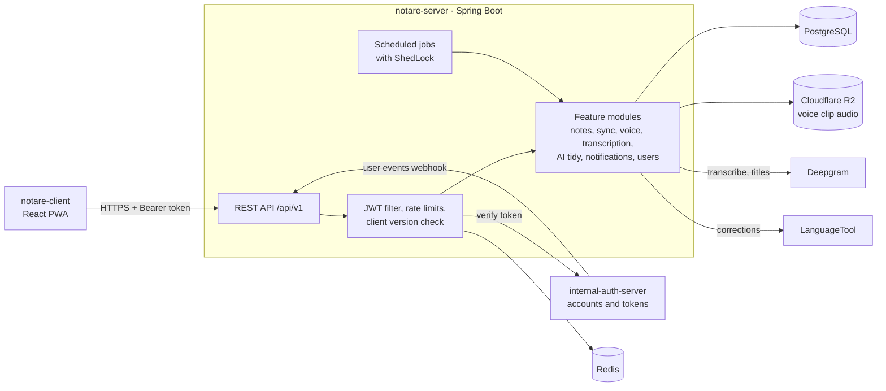
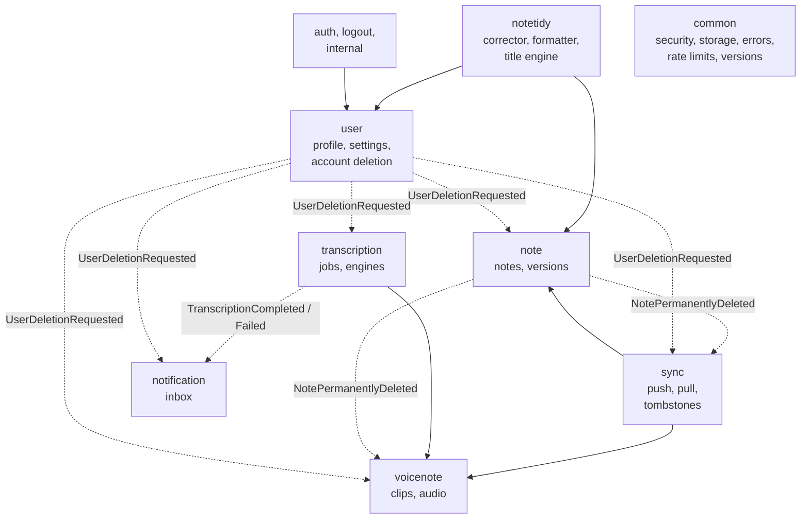
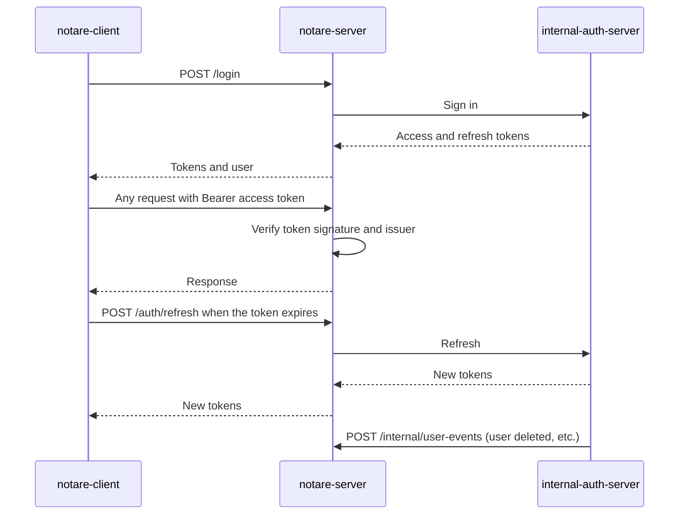
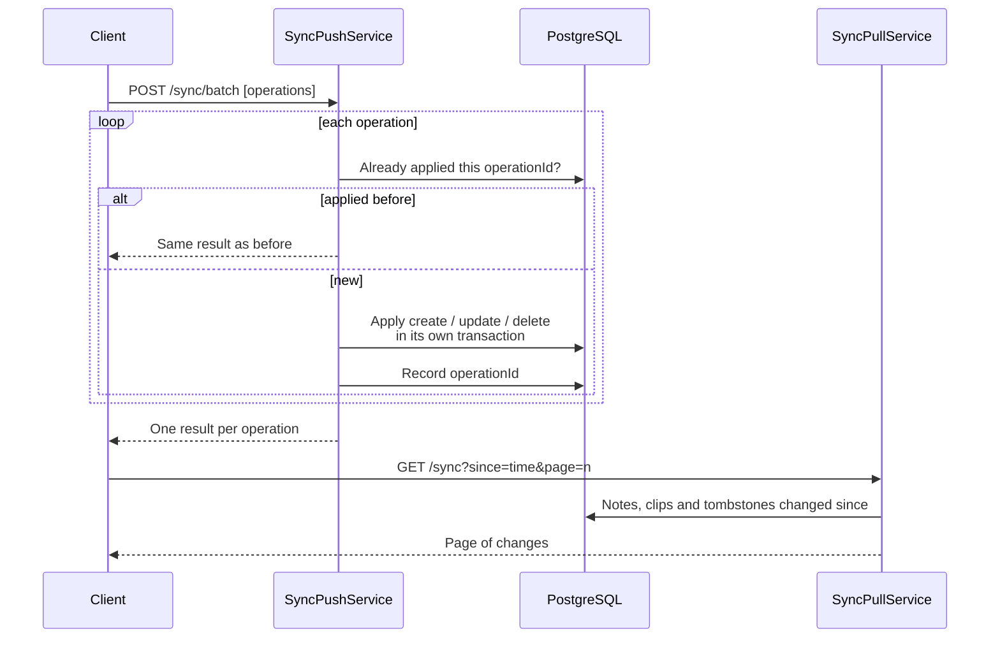
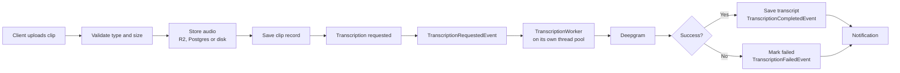
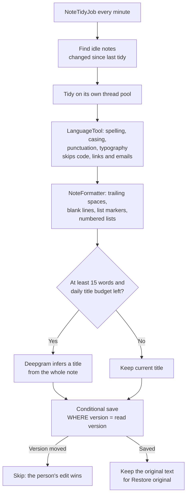

<div align="center">

# Notare Server

**The Spring Boot backend for Notare, an offline-first notes app. It stores notes and voice clips, syncs every device, transcribes speech and tidies notes in the background.**

[](#technology-stack)
[](#technology-stack)
[](#database-and-migrations)
[](#api-reference)

</div>

---

## Table of Contents

1. [Project Overview](#project-overview)
2. [The Problem](#the-problem)
3. [The Solution](#the-solution)
4. [Features](#features)
5. [Technology Stack](#technology-stack)
6. [System Architecture](#system-architecture)
7. [Module Architecture](#module-architecture)
8. [Folder Structure](#folder-structure)
9. [Authentication](#authentication)
10. [Sync Protocol](#sync-protocol)
11. [Voice Clips and Transcription](#voice-clips-and-transcription)
12. [AI Tidy](#ai-tidy)
13. [Account Deletion](#account-deletion)
14. [Background Jobs](#background-jobs)
15. [API Reference](#api-reference)
16. [Database and Migrations](#database-and-migrations)
17. [Installation](#installation)
18. [Environment Variables](#environment-variables)
19. [Build and Run](#build-and-run)
20. [Deployment](#deployment)
21. [Reliability and Security](#reliability-and-security)
22. [Future Improvements](#future-improvements)
23. [Author](#author)
24. [Acknowledgements](#acknowledgements)

---

## Project Overview

**Notare Server** is the backend half of Notare. The [React client](https://github.com/EzeDev98/notare-client) keeps every note on the device and works offline. This server is its sync partner and does the work a phone or browser should not do: it holds the shared copy of every note, stores voice clip audio, transcribes clips, corrects and titles notes, and sends notifications.

This repository contains **only the server**. The client has its own repository and documentation. Accounts and sign-in are handled by a separate identity service, internal-auth-server.

---

## The Problem

An offline-first client changes what the server has to get right:

- **Changes arrive late and out of order.** A device can be offline for days, then send a long queue of edits at once.
- **Retries happen.** A dropped connection means the client cannot tell whether a request landed, so it sends it again.
- **Deletes must travel.** A note deleted on one device has to disappear from a device that was offline at the time.
- **Heavy work can't block a request.** Transcribing audio or checking grammar takes seconds and calls outside services.
- **Background work must not overwrite the person.** Anything the server changes on its own has to lose to a real edit.

---

## The Solution

- **Batch sync with idempotent operations.** The client pushes its queue in one request; each operation carries an id, and applied ids are recorded so a retry is never applied twice.
- **Delta pull with tombstones.** The client asks for everything changed since its last sync, including tombstones for notes deleted for good.
- **Optimistic versions.** Every note has a version. Writes based on an old version are detected, and the latest edit wins.
- **Background workers.** Transcription and AI tidy run off the request thread, on their own thread pools, with retries and recovery after a restart.
- **Conditional background saves.** AI tidy saves only if the note's version has not moved since it was read, so a person's edit always wins.

---

## Features

- Notes: create, update, autosave, pin, delete and search
- Sync: batch push of offline operations and paged delta pull
- Voice clips: upload, stream, download and delete
- Transcription of voice clips with Deepgram, with search across transcripts
- AI tidy: spelling, casing, punctuation and typography fixes with LanguageTool, layout cleanup and an AI title from Deepgram, with "restore original"
- Notifications for finished and failed transcriptions, with unread count
- Account deletion that removes everything a user owns, and finishes if interrupted
- Per-user rate limits backed by Redis
- Minimum client version check (HTTP 426 for out-of-date clients)
- Maintenance mode that turns requests away during a cutover
- OpenAPI documentation with Swagger UI
- Errors as RFC 9457 Problem Details

---

## Technology Stack

| Area | Technology |
|---|---|
| Language | Java 21 |
| Framework | Spring Boot 3.2 (Web, Data JPA, Security, Validation, Actuator) |
| Modularity | Spring Modulith 1.1 events between feature modules |
| Database | PostgreSQL in production, MySQL in development |
| Migrations | Flyway |
| Scheduling | Spring `@Scheduled` with ShedLock, one instance per job |
| Cache and limits | Redis |
| File storage | Cloudflare R2 (S3 API) or Postgres in production, local disk in development |
| Speech to text | Deepgram |
| Corrections | LanguageTool, self-hosted |
| Auth | JWT access tokens issued by internal-auth-server |
| API docs | springdoc-openapi 2.5 |
| Build | Maven, Docker |

---

## System Architecture



---

## Module Architecture

Each feature is a module with the same layers: `web` (controllers), `service`, `repository`, `model`, `dto`, `mapper`, and where needed `event`, `job` and `engine`. Modules talk to each other through events rather than calling into each other's internals.



Solid arrows are direct calls; dotted arrows are events.

---

## Folder Structure

```
notare-server/
├── src/main/java/com/notare/
│   ├── client/              # HTTP client and DTOs for internal-auth-server
│   ├── common/              # Security, storage, errors, rate limits, versions, audit
│   ├── config/              # App, scheduler lock, OpenAPI and web config
│   └── feature/
│       ├── admin/           # Operator-only endpoints
│       ├── auth/            # Sign-in, refresh and activation
│       ├── internal/        # Webhook from internal-auth-server
│       ├── logout/
│       ├── note/            # Notes
│       ├── notetidy/        # AI tidy: job, corrector, formatter, title engine
│       ├── notification/    # Notification inbox
│       ├── sync/            # Sync push and pull
│       ├── transcription/   # Transcription jobs and engines
│       ├── user/            # Users, settings, account deletion
│       └── voicenote/       # Voice clips
├── src/main/resources/
│   ├── application.properties
│   ├── application-prod.properties
│   └── db/migration/        # Flyway migrations
├── compose.yaml             # Local MySQL, Postgres and LanguageTool
├── Dockerfile
└── pom.xml
```

---

## Authentication

Notare does not store passwords. Sign-in, registration, activation and password reset are delegated to **internal-auth-server**, which issues JWT access tokens and refresh tokens.



---

## Sync Protocol



- Every operation runs in its own transaction, so one bad operation does not fail the whole batch.
- Applied operation ids and tombstones are kept for a retention window, then cleaned up by a nightly job.
- Sync requests are rate-limited per user.

---

## Voice Clips and Transcription



- Uploads are idempotent, so a retried upload returns the same clip.
- A recovery job re-queues transcriptions left unfinished by a restart.
- An orphan sweep removes stored files that no clip points at.

---

## AI Tidy

AI tidy is opt-in per user. A job runs every minute and picks notes that are idle, changed since their last tidy and owned by someone who turned tidy on.



- Only safe corrections are applied: a single suggested replacement, in a fixed set of categories, applied from the end of the text backwards.
- The AI title is stored separately from the note text.
- Failures retry with back-off and stop after a maximum number of attempts; a new edit resets the attempts.
- A daily title budget per user caps calls to the title engine.

---

## Account Deletion

Deleting an account publishes `UserDeletionRequested`. Each module deletes the data it owns: notes, clips and their audio, transcriptions, notifications and sync records. Progress is recorded step by step, and a recovery job finishes any deletion that stopped halfway, so a crash mid-delete never leaves data behind.

---

## Background Jobs

All jobs are guarded by ShedLock, so only one server instance runs each job.

| Job | Schedule | What it does |
|---|---|---|
| `NoteTidyJob` | Every minute | Tidies idle notes for users who opted in |
| `StuckTranscriptionRecovery` | Every 10 minutes | Re-queues unfinished transcriptions |
| `AccountDeletionRecoveryJob` | Every 10 minutes | Finishes interrupted account deletions |
| `SyncRetentionJob` | Daily, 03:15 | Deletes expired sync records and tombstones |
| `TrashPurgeJob` | Daily, 03:30 | Deletes notes for good once their purge time has passed |
| `OrphanFileSweepJob` | Daily, 03:30 | Deletes stored files no clip points at |
| `KeepAliveJob` | Every 3 minutes | Pings the server so the host does not put it to sleep |

---

## API Reference

All paths are under `/api/v1`. Full, interactive documentation is served by Swagger UI at `/swagger-ui.html` when the server is running.

| Area | Endpoints |
|---|---|
| Auth | `POST /login`, `POST /auth/refresh`, `POST /logout`, `POST /activation/resend` |
| User | `POST /user/register`, `GET /user/me`, `DELETE /user/me`, `GET` and `PUT /user/me/ai-tidy` |
| Notes | `GET /notes`, `GET /notes/search`, `GET /notes/{id}`, `POST /notes`, `PUT /notes/{id}`, `PATCH /notes/{id}`, `DELETE /notes/{id}`, `POST` and `DELETE /notes/{id}/pin`, `POST /notes/{id}/restore-original` |
| Sync | `GET /sync`, `POST /sync/batch` |
| Voice clips | `POST /voice-notes`, `GET /voice-notes`, `GET /voice-notes/by-note/{noteId}`, `GET /voice-notes/{id}`, `GET /voice-notes/{id}/stream`, `GET /voice-notes/{id}/download`, `DELETE /voice-notes/{id}` |
| Transcription | `POST` and `GET /voice-notes/{id}/transcription`, `GET /transcriptions/search` |
| Notifications | `GET /notifications`, `GET /notifications/unread-count`, `POST /notifications/{id}/read`, `POST /notifications/read-all`, `DELETE /notifications/{id}` |
| Internal | `POST /internal/user-events` (internal-auth-server only) |
| Admin | `POST /admin/database/wipe` (operator only, secret required) |

Errors are returned as [RFC 9457](https://www.rfc-editor.org/rfc/rfc9457) Problem Details, for example a version conflict on a note returns `409` with a `type`, `title` and `detail`.

---

## Database and Migrations

- **Production** runs on PostgreSQL. The schema is owned by Flyway migrations in `src/main/resources/db/migration`, and Hibernate only validates it.
- **Development** runs on MySQL with Hibernate updating the schema, for quick iteration.
- Spring Modulith keeps an event publication table, so events that were published but not yet handled survive a restart.

Main tables: `users`, `notes`, `voice_notes`, `transcriptions`, `notifications`, `sync_operations`, `note_tombstones`, `account_deletions`, `file_blobs` and `shedlock`.

---

## Installation

**Prerequisites:** Java 21, Docker, and a running internal-auth-server.

```bash
# clone the repository
git clone https://github.com/EzeDev98/notare-server.git
cd notare-server

# start LanguageTool (and a database if you don't have one)
docker compose up -d languagetool

# create your dev settings from the template and fill in the values
cp src/main/resources/application-dev.properties.example src/main/resources/application-dev.properties

# run with the dev profile
./mvnw spring-boot:run -Dspring-boot.run.profiles=dev
```

The server starts on port `2001`. Swagger UI is at `http://localhost:2001/swagger-ui.html`.

---

## Environment Variables

Production settings come from environment variables. The main ones:

| Variable | Description |
|---|---|
| `SPRING_PROFILES_ACTIVE` | `prod` in production |
| `PORT` | HTTP port (defaults to `2001`) |
| `DB_HOST`, `DB_PORT`, `DB_NAME`, `DB_USERNAME`, `DB_PASSWORD` | PostgreSQL connection |
| `REDIS_URL` | Redis for rate limits |
| `INTERNAL_AUTH_BASE_URL`, `INTERNAL_AUTH_ISSUER_URI` | Where internal-auth-server lives and the token issuer to trust |
| `INTERNAL_AUTH_CLIENT_ID`, `INTERNAL_AUTH_CLIENT_SECRET`, `INTERNAL_AUTH_CLIENT_APPLICATION_ID` | This app's credentials on internal-auth-server |
| `INTERNAL_AUTH_USER_EVENTS_SECRET` | Shared secret for the user events webhook |
| `JWT_SECRET` | Signs the server's own short-lived tokens |
| `STORAGE_BACKEND` | `r2` or `postgres` in production (development always uses local disk) |
| `R2_ENDPOINT`, `R2_BUCKET`, `R2_ACCESS_KEY_ID`, `R2_SECRET_ACCESS_KEY`, `R2_REGION` | Cloudflare R2 bucket and credentials when `STORAGE_BACKEND=r2` |
| `DEEPGRAM_API_KEY`, `DEEPGRAM_MODEL` | Transcription and titles |
| `TRANSCRIPTION_ENGINE` | `deepgram` or `stub` |
| `TIDY_ENABLED`, `TIDY_CORRECTOR`, `TIDY_ENGINE`, `LANGUAGETOOL_URL` | AI tidy switches and the LanguageTool address |
| `TIDY_IDLE_MINUTES`, `TIDY_BATCH_SIZE`, `TIDY_MAX_ATTEMPTS`, `TIDY_DAILY_TITLE_CAP`, `TIDY_MAX_CHARS` | AI tidy tuning |
| `CLIENT_MIN_VERSION` | Oldest client version accepted |
| `RATE_LIMIT_SYNC_PER_MINUTE` | Sync requests allowed per user per minute |
| `MAINTENANCE_MODE` | `true` to turn requests away during a cutover |
| `ADMIN_WIPE_SECRET` | Secret for the operator wipe endpoint |
| `BASE_URL` | This server's public URL, used by the keep-alive ping |

Never commit secrets. `application-dev.properties` is git-ignored.

---

## Build and Run

```bash
# build the jar
./mvnw clean package

# run it
java -jar target/*.jar --spring.profiles.active=prod

# or build and run the Docker image
docker build -t notare-server .
docker run -p 2001:2001 --env-file .env notare-server
```

---

## Deployment

The server ships as a Docker image (multi-stage: JDK build, JRE runtime) and runs on any container host; it is currently deployed on Render.

- Provide PostgreSQL, Redis and the environment variables above.
- Flyway applies migrations on start-up.
- Run LanguageTool as its own service and point `LANGUAGETOOL_URL` at it, if AI tidy is on.
- Add the client's origin to the CORS allow-list.
- The health check can use `GET /api/v1/keep-alive`, which needs no authentication.

---

## Reliability and Security

- Stateless JWT authentication; tokens are verified against internal-auth-server's issuer.
- Per-user rate limiting in Redis.
- Idempotent sync operations and uploads, safe to retry.
- Optimistic versioning on notes; background writes are conditional.
- ShedLock keeps scheduled jobs to one instance.
- Durable module events with Spring Modulith's event publication registry.
- Graceful shutdown of worker thread pools.
- Consistent Problem Details error responses.
- Micrometer counters for AI tidy.

---

## Future Improvements

- Shared notes and live collaboration
- Push notifications
- End-to-end encryption of note content
- A self-hosted language model for titles
- Per-user export of all data

---

## Author

**Eze Moses John** · [Building with Eze on YouTube](https://www.youtube.com/@buildingwitheze?sub_confirmation=1)

---

## Acknowledgements

- [Spring Boot](https://spring.io/projects/spring-boot) and [Spring Modulith](https://spring.io/projects/spring-modulith)
- [Flyway](https://flywaydb.org/) and [ShedLock](https://github.com/lukas-krecan/ShedLock)
- [Deepgram](https://deepgram.com/): speech to text and titles
- [LanguageTool](https://languagetool.org/): spelling and grammar
- [Cloudflare R2](https://www.cloudflare.com/developer-platform/r2/): voice clip storage
